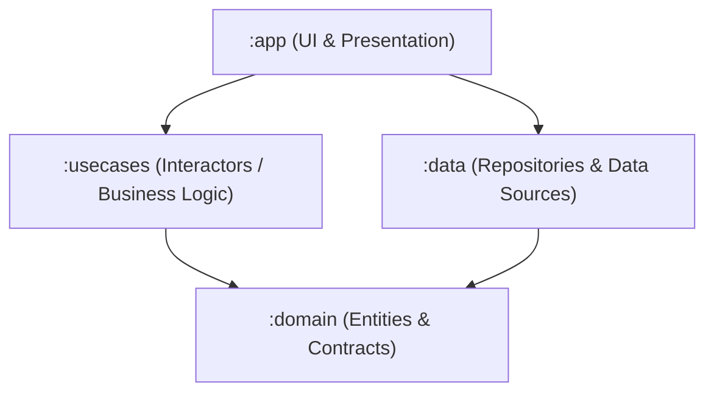
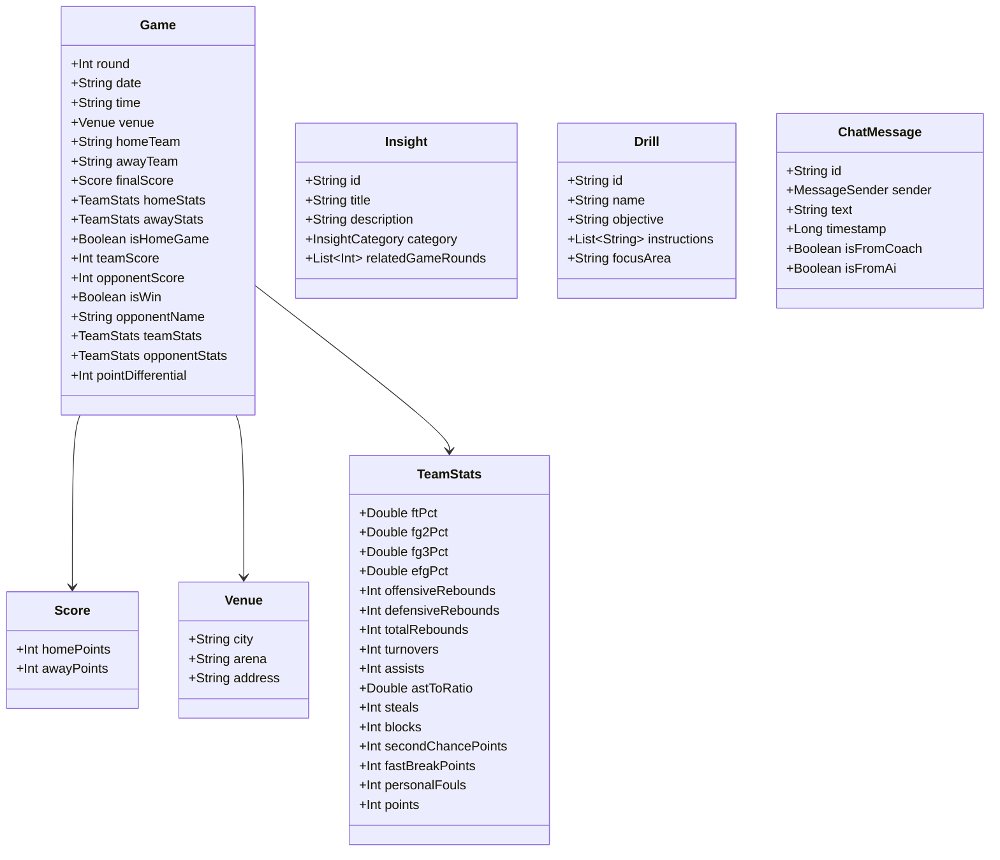
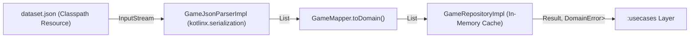

# BasketCoach Architecture

## 1. Overview & System Topology

BasketCoach is structured around a **Layer-Based Clean Architecture** topology across four primary modules:

### Module Responsibilities & Dependencies

| Module | Purpose | Allowed Dependencies | Platform Target |
| :--- | :--- | :--- | :--- |
| **`:domain`** | Core basketball domain entities, value objects, typed errors (`DomainError`), and repository contracts. | None (pure Kotlin JVM, zero external/Android dependencies). | Pure Kotlin JVM (`libs.plugins.kotlin.jvm`) |
| **`:usecases`** | Single-responsibility domain interactors orchestrating business workflows. | `:domain` | Pure Kotlin JVM / Android |
| **`:data`** | Repository implementations, local data parsing (`dataset.json`), database persistence (`Room`), and remote AI clients (`DevExpert API`). | `:domain` | Android / JVM |
| **`:app`** | Tablet Landscape Jetpack Compose UI, MVVM ViewModels with Hybrid UI State, and Hilt dependency injection root. | `:domain`, `:usecases`, `:data` | Android Application |

---

## 2. Domain Layer Governance (`:domain`)

The `:domain` module is the innermost layer and embodies the core business rules of basketball analytics:

- **Strict Pure Kotlin Mandate**:
  Zero Android framework dependencies (`android.*`). All types, collections, and primitives are pure Kotlin (`kotlin.*`).
- **Immutable State Representation**:
  Entities and value objects are modeled as immutable Kotlin `data class` types with `val` properties.
- **Single Source of Domain Truth**:
  Constants such as `OUR_TEAM_NAME = "BASQUETPIASABADELL BLAU"` reside directly in `:domain`, enabling dynamic resolution of home/away perspective, score differentials, and win/loss records.
- **Typed Functional Error Modeling**:
  Repository contracts return `Result<T, DomainError>` sealed hierarchies rather than throwing raw runtime exceptions, preventing technology leaks from data sources.

---

## 3. Core Domain Entities & Taxonomy

### Domain Repositories (Contracts in `:domain`)
- **`GameRepository`**: Access to historical Phase 1 game fixtures and team box scores.
- **`AiAnalysisRepository`**: Querying tactical AI insights and recommended practice drills.
- **`ChatRepository`**: Single-thread conversational assistant interaction with the DevExpert AI service.

---

## 4. Data Layer Governance & Parsing Pipeline (`:data`)

The `:data` module provides repository implementations and data adapters for raw data sources while keeping `:domain` isolated from serialization annotations and transport schemas.

### Key Architectural Patterns in `:data`
1. **DTO Separation (`data.dto`)**:
   Raw snake_case JSON schemas are mapped into immutable `@Serializable` DTOs (`GameDto`, `ScoreDto`, `TeamStatsDto`). `:domain` remains completely clean of serialization dependencies.
2. **DTO-to-Domain Mapping (`data.mapper`)**:
   `GameMapper` converts DTOs to pure domain entities. It constructs domain value objects (`Venue`, `Score`) and injects points scored into `TeamStats.points` directly from the match final score.
3. **Bundled Classpath Resource Strategy**:
   The static 14-game dataset is packaged at `data/src/main/resources/dataset.json`. This allows the pure JVM module to load data via the classloader without requiring an Android `Context`, enabling sub-second unit test execution.
4. **In-Memory Caching (SSOT)**:
   Because Phase 1 is a static 14-match historical dataset, `GameRepositoryImpl` lazily parses the payload on the first query and caches the sorted `List<Game>` in memory. Subsequent calls to `getPhase1Games()` or `getGameByRound(round)` resolve synchronously without re-parsing.
5. **Defensive Error Handling**:
   `GameJsonParserImpl` wraps parsing within `try-catch` blocks returning `Result.Error(DomainError.Local.DatabaseError)`. Missing resources or unmatched round queries return `Result.Error(DomainError.Local.NotFound)`.
