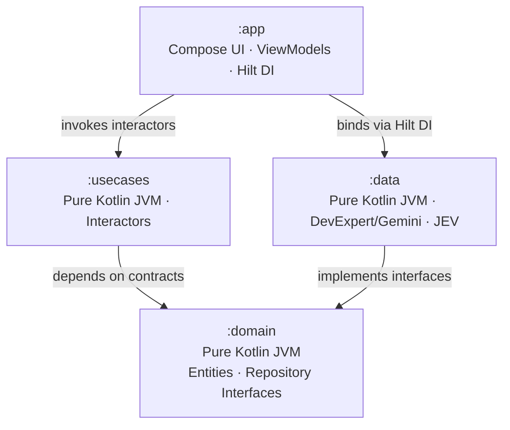
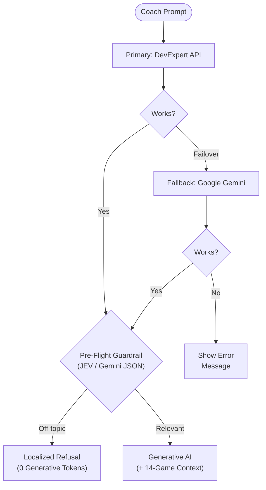
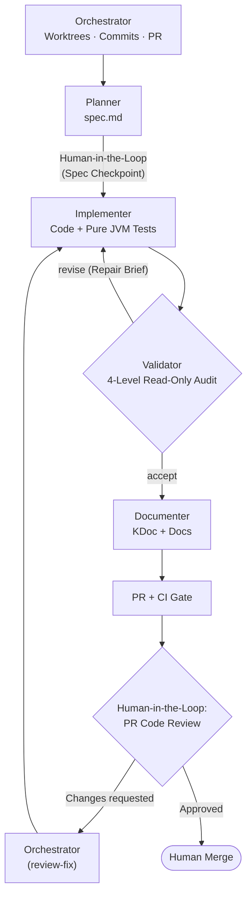

# BasketCoach

**BasketCoach** is an Android **Tablet Landscape** application built for the coach of **CEB Escola Pia Sabadell** (Junior Men's Interterritorial). It analyzes a **static, bundled 14-game dataset** from Phase 1 at the team and opponent level—without individual player tracking or remote database sync—to turn past match statistics into concrete tactical adjustments and training plans for Phase 2.

Beyond the product itself, BasketCoach serves as a **practical end-to-end showcase of the [Android AI Workflow Foundation](https://github.com/albertmartorell1975/android-ai-workflow-foundation)**, built through a spec-driven, multi-agent engineering pipeline with strict Clean Architecture boundaries and automated quality gates.

---

## Goal & How AI Supports the Coach

Manually cross-referencing 14 full basketball box scores between competition phases makes it difficult to spot recurring tactical patterns. BasketCoach bridges the gap between raw Phase 1 statistics and **Phase 2 court preparation** with one clear objective: **eliminate repeating team weaknesses and double down on winning synergies** against upcoming opponents.

Rather than relying on generic LLM advice, the AI acts as a data-grounded assistant coach across three connected steps:

1. **Establish an Objective Baseline**: Consolidates every Phase 1 team and opponent metric into clear visual indicators—scoring differentials, rebounding balance, shooting efficiency, and ball control (assist-to-turnover ratio).
2. **Diagnose Patterns Without Hallucinations**: Sends all 14 box scores to the AI using deterministic structured outputs under FIBA competition rules, surfacing prioritized **Strengths** and **Improvement Areas** tied to real metrics and specific game rounds (such as turnover spikes, defensive rebounding deficits, or foul trouble), alongside targeted **practice drills**.
3. **Translate Insights into Weekly Training**: Through topic-scoped **Chat** threads launched directly from any improvement area (or via *Open Inquiry*), the coach can explore root causes, discuss tactical adjustments, and refine practice drills tailored to the team's weekly schedule.

---

## Core Features

- **Dashboard**: Visualizes the static Phase 1 dataset through a baseline overview, four KPI pillars (*Scoring*, *Rebounds & Balance*, *Shooting Efficiency*, *Game Control*), a 14-round scoring evolution chart, and a full match-by-match statistical table.
- **Tactical Analysis**: Displays AI-generated strengths, improvement areas, and practice drills strictly grounded in the 14-game dataset via structured JSON outputs (`temperature = 0.2`) and in-memory caching. Supports category filtering and one-tap *"Explore in Chat"* hand-off.
- **Chat**: A two-pane tablet interface pairing AI-detected improvement areas and an *Open Inquiry* option on the left with isolated, topic-scoped coaching threads on the right. Every incoming prompt is first evaluated by the deterministic **JEV** classification model to block off-topic requests before invoking generative AI.

---

## Architecture

BasketCoach uses a **Layer-Based Clean Architecture** across four Gradle modules. All business logic, use cases, and data transport live in **pure Kotlin JVM** modules with zero Android framework dependencies, wired together by Hilt in the Android presentation module:



> Architectural deep dives: [ARCHITECTURE.md](ARCHITECTURE.md) · [CONSTRAINTS.md](CONSTRAINTS.md) · [DESIGN.md](DESIGN.md)

---

## AI Pipeline, JEV Guardrail & Dual-Provider Failover

To prevent statistical hallucinations, all AI requests are empirically grounded with aggregated Phase 1 box-score metrics and framed around FIBA competition rules. Conversational queries pass through a two-stage pipeline anchored by a deterministic semantic firewall:



- **Empirical Context Grounding**: Rather than using vector-based RAG, every analysis and chat request deterministically injects an aggregated summary and round-by-round breakdown of all 14 Phase 1 games (along with the active improvement area's diagnosis in topic-scoped threads), preventing retrieval gaps and statistical hallucinations.
- **Deterministic JEV Guardrail**: Chat queries are never sent directly to the generative model. They are first classified—via DevExpert's deterministic `jev` model, or Gemini's JSON classifier when in fallback—as basketball-relevant or off-topic. Off-topic prompts short-circuit immediately without consuming generative tokens.
- **Dual-Provider Resilience**: Both Tactical Analysis and Chat use DevExpert Inference (`chat` and `jev`) as the primary provider, with Google Gemini's OpenAI-compatible endpoint (`gemini-4-hydrogen`) as an automatic fallback. Auth, subscription/quota, rate-limit, server, or timeout errors transparently switch and latch the active session to Gemini, while genuine offline network errors remain unlatched. If no DevExpert key is configured, the app boots directly on Gemini.

> Detailed specs: [Structured Outputs](docs/chat/ai-tactical-analysis-structured-outputs.md) · [Chat Architecture](docs/chat/ai-chat-architecture.md)

---

## Built with the Android AI Workflow Foundation

This repository is a live reference implementation of the **[Android AI Workflow Foundation](https://github.com/albertmartorell1975/android-ai-workflow-foundation)** (configured under [.agents/](.agents/skills/README.md)):



- **Discovery & Project Harness**: Initialized from [docs/build-brief.md](docs/build-brief.md) and [CONTEXT.md](CONTEXT.md) into a structured harness ([AGENTS.md](AGENTS.md), [CONSTRAINTS.md](CONSTRAINTS.md), [feature_list.json](feature_list.json), [PROGRESS.md](PROGRESS.md)) with per-feature specs, validation reports, and PR review logs under [docs/features/](docs/features/).
- **Orchestrated Multi-Agent Pipeline**: A master Orchestrator manages isolated `git worktree` environments, atomic commits, and PR delivery across dedicated Planner, Implementer, read-only Validator, and Documenter subagents, with configurable human checkpoints (`require_review_after`) before implementation and at PR merge.
- **Post-PR Review Loop (`review-fix`)**: When code review comments are posted on an open Pull Request, the Orchestrator extracts the feedback and triggers an Implementer → Validator → Documenter repair cycle before pushing the update for human merge.
- **Modular Skills, Guardrails & CI**: Agents load 37 specialized Android engineering skills on demand ([.agents/skills/README.md](.agents/skills/README.md)), pre-execution safety hooks block destructive commands and enforce instruction budgets, strict rules mandate pure JVM unit tests without Robolectric bloat, and a GitHub Actions gate ([.github/workflows/gate.yml](.github/workflows/gate.yml)) verifies unit tests and Android lint on every PR.

---

## Tech Stack

- **Core & Build**: Kotlin `2.2.10` · Java `17` · AGP `9.4.1` · KSP `2.2.10-2.0.2` · Android (`minSdk 34` / `targetSdk 37`)
- **UI**: Jetpack Compose (BOM `2026.02.01`, Material 3) · Type-safe Navigation Compose `2.8.5`
- **DI & Async**: Hilt `2.60.1` · Kotlinx Coroutines `1.9.0`
- **Networking & Config**: OkHttp `4.12.0` · Kotlinx Serialization `1.7.3` · `secrets-gradle-plugin` `2.0.1`
- **Testing**: JUnit `4.13.2` · `kotlinx-coroutines-test` · OkHttp `MockWebServer`

---

## Build & Verification

```bash
# Build the debug APK
./gradlew assembleDebug

# Run all pure JVM unit tests and Android lint (matches CI gate)
./gradlew testDebugUnitTest lintDebug --parallel --build-cache --configuration-cache
```
