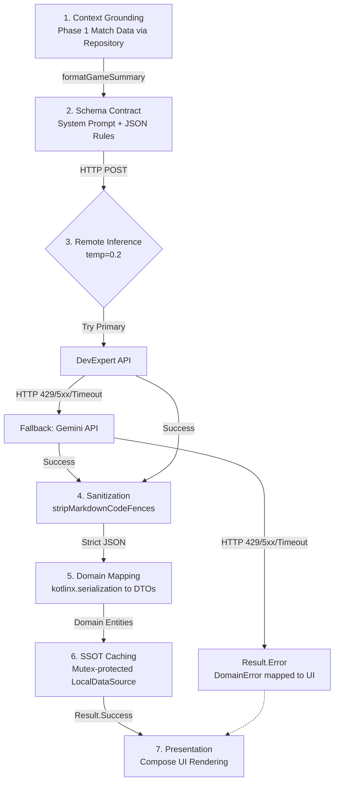

# AI Tactical Analysis & Structured Outputs Pattern

> Part of the core application architecture. See also: [ARCHITECTURE.md](../../ARCHITECTURE.md).

## 1. Executive Summary

Large Language Models (LLMs) are probabilistic sequence predictors that naturally output unstructured prose. However, BasketCoach's native Android Compose UI requires **deterministic, typed, and crash-resilient data models** to render Insight Cards, metric panels, and filtered tabs.

To bridge this gap, BasketCoach implements the **Structured Outputs Pattern**. This pattern forces the remote inference engine to act as a deterministic **JSON microservice**, adhering strictly to a predefined schema contract that maps directly to Kotlin DTOs.

---

## 2. End-to-End Pipeline Architecture



---

## 3. Core Components

### 3.1 Grounding Context (Zero-Assumption Rule)
To prevent hallucinations, the AI is never asked to guess statistics. The 14 Phase 1 matches are synthesized into a structured text prompt before querying the LLM.

```kotlin
// Concept: Synthesizes raw game data into an empirical baseline prompt
fun formatGameSummary(games: List<Game>): String {
    // Calculates averages, AST/TO ratios, rebounding margins...
    return """
        PHASE 1 SUMMARY FOR $OUR_TEAM_NAME:
        - Record: $wins Wins, $losses Losses
        - Ball Security: Overall AST/TO: $avgAstTo
        - Rebounding Margin: $rebMargin
        ...
    """.trimIndent()
}
```

### 3.2 The System Prompt Schema Contract
The system prompt establishes the persona, rules, and the mandatory JSON schema structure. Null values are strictly forbidden, and properties like `category` or `sentiment` are restricted to specific Enum strings.

```json
{
  "insights": [
    {
      "id": "insight-1",
      "title": "Concise headline",
      "category": "OFFENSE", 
      "type": "STRENGTH",
      "metric": {
        "primaryLabel": "Percentatge T2 Zona",
        "primaryValue": "58.4%",
        "sentiment": "POSITIVE"
      }
    }
  ],
  "drills": [...]
}
```

### 3.3 Low-Entropy Inference & Sanitization
Inference is executed with **`temperature = 0.2`** to guarantee maximum schema compliance. Because LLMs sometimes wrap valid JSON in Markdown code fences (` ```json `), the data source safely strips these fences before parsing.

```kotlin
val rawContent = executeChatCompletion(requestDto) // temp = 0.2
val sanitizedJson = stripMarkdownCodeFences(rawContent)
return json.decodeFromString<AiAnalysisResponseDto>(sanitizedJson)
```

### 3.4 In-Memory Caching (SSOT)
Since Phase 1 is a static 14-game dataset, analysis is generated only once per session. The `AiAnalysisLocalDataSourceImpl` caches the results behind a `kotlinx.coroutines.sync.Mutex`. Subsequent UI recompositions or screen transitions fetch instantly from cache, saving tokens and latency.

---

## 4. Error Handling & Resilience

Technical failures are mapped to typed `DomainError` classes, which the UI translates into localized messages without leaking Android dependencies into the Data or Domain layers.

| Technical Failure | Cause | DomainError | UI Handling |
| :--- | :--- | :--- | :--- |
| `SocketTimeoutException` | LLM latency > 60s | `Network.Timeout` | "Temps d'espera esgotat" |
| `HttpException(401)` | Invalid API Key | `Network.Unauthorized` | "No autoritzat" |
| `HttpException(5xx)` | Upstream outage | `Network.ServerError` | "Error del servidor" |
| `SerializationException` | Model broke JSON schema | `Generic` | "Error de format de dades" |
| `IOException` | Airplane Mode / Offline | `Network.NoInternet` | "Sense connexió a Internet" |

---

## 5. Architectural Benefits

1. **Type Safety & Zero UI Crashes**: The UI binds to strongly typed Kotlin data classes (`Insight`), never to raw JSON.
2. **Zero Hallucinations**: Grounding ensures the AI bases every conclusion on actual box score numbers.
3. **Decoupled Architecture**: Clean Architecture ensures the UI knows nothing about HTTP or JSON.
4. **Performance**: In-memory caching prevents redundant API invocations, minimizing latency and token costs.
